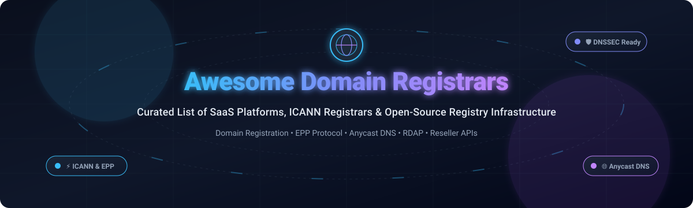

# 🌐 Awesome Domain Registrars 🚀

**A curated directory of top-tier SaaS domain registrars, ICANN-accredited providers, EPP software, DNS management suites, and open-source registry infrastructure.**

  
  
  
  
  
  
  

*Empowering developers, sysadmins, domain investors, and registry operators with transparent pricing, battle-tested tools, and open-source infrastructure.*

**Last updated:** October 2026

---

## 📑 Table of Contents

- [📊 Sector Overview & Market Dynamics](#-sector-overview--market-dynamics)
- [☁️ SaaS/Hosted Platforms](#️-saashosted-platforms)
- [🔓 Open-Source GitHub Projects](#-open-source-github-projects)
- [🛠️ Developer Tools & Libraries](#️-developer-tools--libraries)
- [📈 Star History](#-star-history)
- [🤝 How to Contribute](#-how-to-contribute)
- [💖 Support](#-support)
- [⚖️ Disclaimer](#️-disclaimer)

---

## 📊 Sector Overview & Market Dynamics

The global domain name registrar market is valued at approximately **$2.5B–$2.7B** (with over 400 million active domain registrations globally across all TLDs) and is expanding at a steady CAGR of ~4.5%. The sector exhibits a **dual structure**: heavily concentrated at the top where an oligopoly of leading players (GoDaddy, Namecheap/Spaceship, Tucows, IONOS) accounts for ~30–35% of total volume, yet moderately-to-highly fragmented across the remaining ~65–70% among 1,500+ ICANN-accredited registrars, web hosting consolidators, and regional/niche reseller networks.

---

## ☁️ SaaS/Hosted Platforms

| Platform | Company Scale (Revenue / Valuation) | Pricing (Starting Tier) | Free Tier / Trial Limits | Description |
| :--- | :--- | :--- | :--- | :--- |
| **[Cloudflare Registrar](https://www.cloudflare.com/products/registrar/)** | ~$69.1B Market Cap / $2.17B Rev (FY25) | At-cost pricing (e.g., ~$10.44/yr for `.com` registration & renewal with zero markup) | Free tier available: Free authoritative DNS, DDoS mitigation, universal SSL/TLS, and 3 Page Rules forever (no free domain registration; domains billed at ICANN wholesale cost) | Sells domains strictly at cost with zero retail markup or renewal spikes. Free WHOIS privacy and 1-click DNSSEC included; requires using Cloudflare nameservers. |
| **[GoDaddy](https://www.godaddy.com/)** | ~$17.1B Market Cap / $4.95B Rev (FY25) | $0.01 to $1.99 1st yr `.com` (renews at $22.99/yr); standard tiers from $12.99/yr | 7-day free trial on GoDaddy Airo Website Builder & Hosting (no credit card required; domain registration not included free) | Largest registrar by volume. 500+ extensions, AI-assisted setup via GoDaddy Airo, auctions, Discount Domain Club, and CashParking. |
| **[IONOS](https://www.ionos.com/)** | ~€4.5B Market Cap (~$4.8B) / €1.32B Rev (FY25) | $1.00 1st yr `.com` (renews at $17.00/yr); bundled hosting plans start at $1.00/mo | 30-day money-back guarantee trial on hosting and domain bundles; no permanent free domain plan | European hosting and registrar giant (formerly 1&1). Offers 600+ extensions, free WHOIS privacy, 24/7 phone support, and Wildcard SSL. |
| **[Namecheap](https://www.namecheap.com/)** | $1.5B Valuation / $398M Rev (FY24) | $10.98 1st yr `.com` (renews at $18.48/yr); other TLDs start at $0.99/yr | 30-day free trial for Spacemail / Namecheap Private Email (1 mailbox, 5GB email storage, 2GB file storage; domains require paid purchase) | High-volume consumer-favorite registrar founded in 2000. Includes free Lifetime WHOIS privacy (WhoisGuard) and DNS with up to 100 subdomains per domain. |
| **[Hover](https://www.hover.com/)** | ~$390M Parent Rev (Tucows NASDAQ: TCX) / ~$70M Segment Rev | $18.99/yr flat `.com` registration & renewal; alternative TLDs start at $4.99/yr | No free trial; 30-day money-back grace period on select domain registrations & Tucows services | Retail registrar brand of Tucows focusing on clean, no-upsell domain management, transparent flat renewals, and tiered volume discounts for 10+ domains. |
| **[NameSilo](https://www.namesilo.com/)** | ~$95M Market Cap (CSE: URL) / $65.5M Rev (FY25) | $11.05/yr flat `.com` ($8.75/yr with volume discount); entry TLDs from $1.99/yr | Free DNS management and lifetime WHOIS privacy on all accounts; 30-day free trial for Titan Professional Email | Publicly traded registrar known for lowest 5-year total ownership cost ($11.05/yr flat for `.com`), zero transfer fees, and discount program via account top-up. |
| **[Dynadot](https://www.dynadot.com/)** | ~$15M–$20M Est. Revenue / Privately held | $10.99 1st yr `.com` (renews at $12.99/yr); entry promos start at $1.88/yr | Free tier includes free one-page website builder (with Dynadot branding, 1 page limit), free DNS hosting, and free WHOIS privacy | Renowned for domain investing, aftermarket auctions, RESTful v2 API with HMAC secret authentication, and arbitrary domain WHOIS lookup capability. |
| **[Spaceship](https://www.spaceship.com/)** | Backed by Namecheap Group ($1.5B Val / $398M Rev) | $9.98/yr flat `.com` registration and renewals; promo extensions from $0.88/yr | Free lifetime WHOIS privacy, free Spacemail starter mailbox trial (30 days), and free 100 URL/email forwarding rules forever | Next-generation registrar platform with flat $9.98 `.com` renewals, default DNSSEC, Spacemail integration, and built-in domain portfolio management. |
| **[Gandi](https://www.gandi.net/)** | ~$10M–$25M Est. Segment Revenue (European Domain Group) | €17.53/yr (~$19.10/yr) for `.com`; specialty TLDs starting at €4.99/yr | Free tier includes 2 free 3GB Webmail mailboxes and 1,000 email forwarders per domain for life with any active domain registration | Established European registrar with a privacy-first ethos ("No Bullshit"), PAT API access, free SSL certificate for 1 year per domain, and standard DNSSEC. |
| **[Porkbun](https://porkbun.com/)** | Bootstrap / Privately held (>4M domains managed) | $9.98 1st yr `.com` (renews at $10.98/yr); entry TLDs start at $1.50/yr | Free tier includes free WHOIS privacy, free SSL certificate, free URL forwarding, and 3-month free trial of professional email hosting | Developer-friendly registrar known for low margins, free developer JSON v3 API, free WHOIS privacy, URL and email forwarding, and free SSL certificates. |

---

## 🔓 Open-Source GitHub Projects

*Open-source platforms, complete registries, and full registrar billing engines sorted by GitHub stargazers count (descending):*

- **[PowerDNS](https://github.com/PowerDNS/pdns)**   
  High-performance, authoritative and validating DNS server software powering major registries, registrars, and telecommunication carriers globally. Supports DNSSEC out of the box and features RESTful management APIs.

- **[Nomulus (Google Registry)](https://github.com/google/nomulus)**   
  Google's open-source, cloud-based Top Level Domain (TLD) domain registry platform running on Google Cloud Platform (GCP). Operates Google's portfolio of TLDs (such as `.app`, `.dev`, `.how`), fully implementing ICANN-compliant registry capabilities including EPP, WHOIS, RDAP, and DNSSEC.

- **[FOSSBilling](https://github.com/FOSSBilling/FOSSBilling)**   
  Free, open-source hosting billing and domain registrar management software. Provides modular domain registrar plugins (supporting Namecheap, ResellerClub, Enom, and generic EPP gateways), automated invoicing, client portals, and domain renewal workflows.

- **[Domain Watchdog](https://github.com/maelgangloff/domain-watchdog)**   
  Modern monitoring application that inspects domain registrations via RDAP, logs domain history changes, tracks expiration dates, and alerts users to acquire domains the moment they drop.

- **[metaregistrar/php-epp-client](https://github.com/metaregistrar/php-epp-client)**   
  The most comprehensive object-oriented PHP EPP (Extensible Provisioning Protocol) client library. Implements RFC 5730-5734, supporting connections and domain transactions across dozens of registry backends (including Verisign, Nominet, SIDN, EURid, and Donuts).

- **[Namingo Registry](https://github.com/getnamingo/registry)**   
  Open-source domain registry platform tailored for modern ccTLD, gTLD, private brand, and local registry operations. Provides full EPP server functionality, WHOIS/RDAP gateways, DNSSEC automation, and multi-tier registrar management.

- **[manage.get.gov (CISA)](https://github.com/cisagov/manage.get.gov)**   
  Production-grade Django-based registrar application operated by the Cybersecurity and Infrastructure Security Agency (CISA) to power `.gov` domain management and directly interface with the registry via EPP.

- **[Domainr EPP](https://github.com/domainr/epp)**   
  Fast, idiomatically structured Go library for communicating with ICANN and ccTLD registries using EPP (Extensible Provisioning Protocol).

- **[Namingo Registrar](https://github.com/getnamingo/registrar)**   
  Open-source ICANN-accredited domain registrar management system built atop FOSSBilling (PHP). Ideal for organizations, hosting companies, and resellers launching ICANN-compliant registrar storefronts.

- **[AfriCC php-epp2](https://github.com/AfriCC/php-epp2)**   
  High-level EPP TCP/SSL client library for PHP with extensive protocol extension support for domain creation, contact handling, nameserver updates, and transfers.

- **[Internet.ee Registry (EIS)](https://github.com/internetee/registry)**   
  Official open-source TLD Registry management system developed by the Estonian Internet Foundation (EIS) for operating the `.ee` ccTLD, featuring automated EPP interfaces, auction system, and registrar portal.

- **[OpenDomain](https://github.com/nodeloc/opendomain)**   
  Free secondary domain distribution platform integrating PowerDNS (Go + Gin + PostgreSQL + Redis + Vue 3). Features real-time availability checks, DNS record management, OAuth, domain health scanning, and Telegram notifications.

- **[masalachai/epp-client](https://github.com/masalachai/epp-client)**   
  Memory-safe, high-performance EPP client library in Rust designed for automated domain registration, lifecycle operations, and registrar integrations.

- **[PyRar](https://github.com/james-stevens/pyrar)**   
  Open-source EPP DNS Registrar and self-contained Registry in Python (single Docker container). Manages domain purchasing, renewal, DNS hosting, and PowerDNS signing with built-in NSEC3+OptOut DNSSEC.

- **[FRED (CZ.NIC)](https://github.com/CZ-NIC/fred-server)**   
  The leading open-source domain Registry system developed by CZ.NIC (.cz registry). Handles 200 registry operations/sec and up to 20 million domains across national ccTLDs worldwide.

- **[go-registrar](https://github.com/timapril/go-registrar)**   
  Proof-of-concept Domain Registrar in Go with a GPG signature-based audit trail for all changes to sponsored domains, built to eliminate domain hijacking risks.

---

## 🛠️ Developer Tools & Libraries

- **[mcpdomain](https://www.npmjs.com/package/mcpdomain)** — The first domain registrar built natively for AI agents as a Model Context Protocol (MCP) server. Enables purchasing, DNS configuration, and domain management directly inside Claude, ChatGPT, and Cursor.
- **[DigitalPlat FreeDomain](https://github.com/DigitalPlat)** — Open-source free domain project (AGPL-3.0) backed by The Hack Foundation (501(c)(3) nonprofit) providing subdomains (.DPDNS.ORG, .US.KG, .QZZ.IO).
- **[DNSHE Free Domains](https://github.com/dnshe/DNSHE-FreeDomains)** — Free subdomains for developers with Anycast DNS and REST API automation (.de5.net, .us.ci, .cc.cd).
- **[BulkDomainAvailabilityChecker](https://github.com/vladmycode/BulkDomainAvailabilityChecker)**  — Multi-threaded Python tool for batch domain lookup and research.

---

##  Star History

---

## 🤝 How to Contribute

Contributions are always welcome! Whether you are adding a new domain registrar, updating pricing models, or sharing an open-source tool:

1. **Fork the repository** to your own GitHub account.
2. **Create a branch** for your feature or correction (`git checkout -b feature/add-registrar`).
3. **Add or edit entries** in `README.md` keeping descriptions factual, concise, and linked to authoritative sources. Ensure any SaaS entries include exact pricing and free tier/trial limits.
4. **Submit a Pull Request** with a brief summary of what you've added or updated.

---

## 💖 Support

If you found **Awesome Domain Registrars** helpful, consider showing your support:

- ⭐ **Star this repository** to help others discover it!
- 🍴 **Fork and share** it with fellow developers, sysadmins, and domain enthusiasts.
- ☕ **Sponsor or buy a coffee**: Support ongoing maintenance and open-source contributions via the [GitHub Sponsors Dashboard](https://github.com/sponsors/ishandutta2007).

Thank you for being part of the open-source and domain infrastructure community! 🙌

---

## ⚖️ Disclaimer

- This is a **community-curated** list for educational, technical, and informational purposes. Mention does not constitute an official endorsement.
- Domain registrars and registry operators must comply with ICANN policies, registry agreements, and applicable data privacy regulations (GDPR, CCPA).
- **Renewal pricing is the true cost metric**: promotional rates are acquisition tools, whereas renewal rates represent sustained ownership expense.
- Self-hosted registry and registrar architectures require proper security hardening, DNSSEC deployment, and operational compliance.

---

  Maintained with ❤️ by <a href="https://github.com/ishandutta2007">Ishan Dutta</a> and the open-source community.

